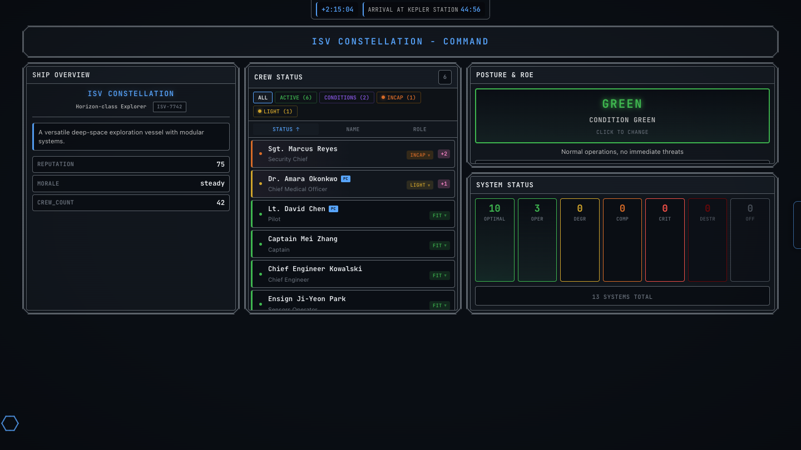
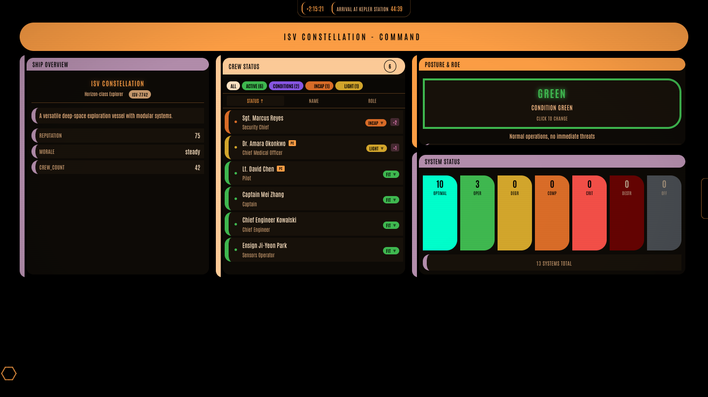
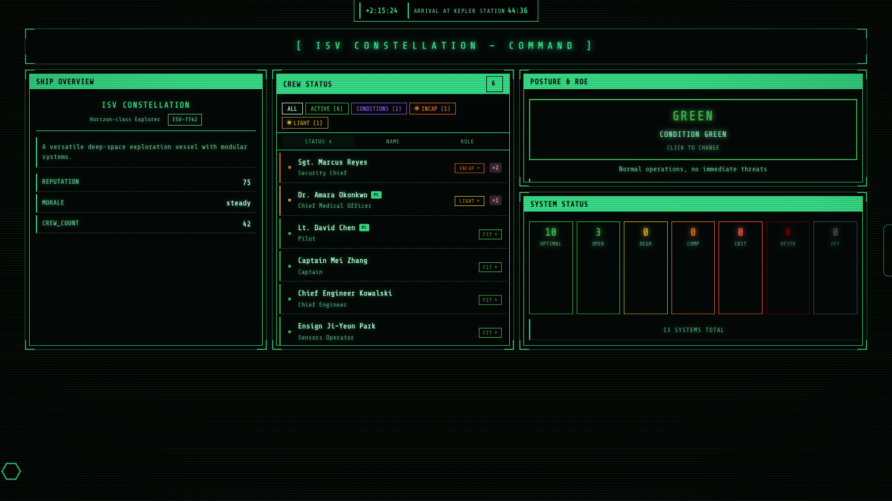
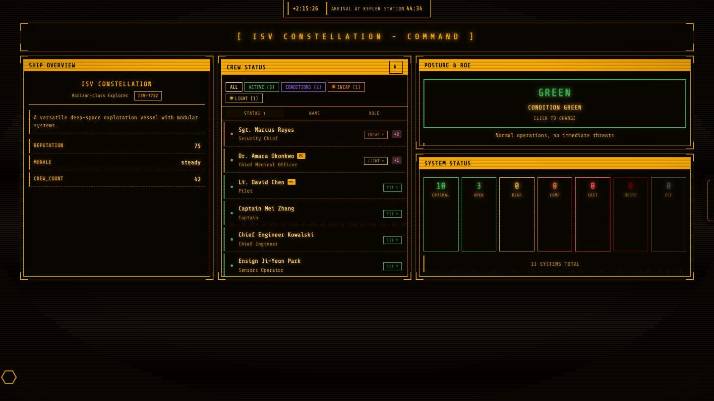
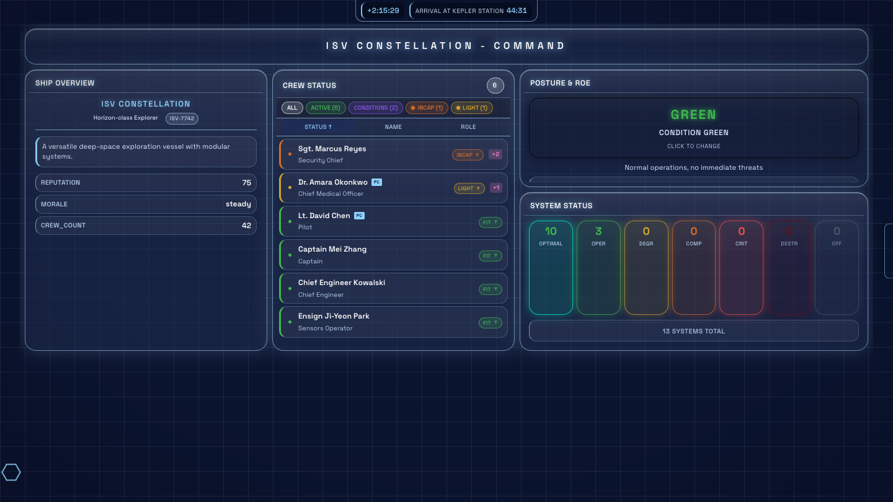
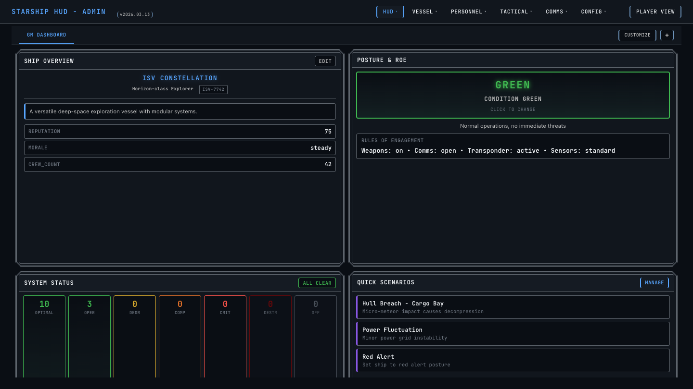

<p align="center">
  <picture>
    <source media="(prefers-color-scheme: dark)" srcset="docs-user/assets/starship-hud-logo-dark.svg" />
    
  </picture>
</p>

<h1 align="center">Starship HUD</h1>

<p align="center">
  <strong>Your tabletop ship, with a real bridge.<br/>Each player gets a station console with live status, alerts and controls, while the GM runs the ship from behind the screen. Self-hosted in one container.</strong>
</p>

<p align="center">
  <a href="#features">Features</a> •
  <a href="#screenshots">Screenshots</a> •
  <a href="#getting-started">Getting started</a> •
  <a href="#documentation">Documentation</a> •
  <a href="CONTRIBUTING.md">Contributing</a>
</p>

<p align="center">
  
  
  
  
  
</p>

---

## Why Starship HUD?

**The ship is a character.** In a sci-fi campaign the ship is where the party lives, and it should
feel like it: systems that strain and fail, alarms that matter, a captain who can glance at a
console and know what kind of day it is. Starship HUD puts that console on the table.

1. **Players get stations.** Command, Engineering, Sensors, Comms, Tactical: each player opens
   their own console on a laptop or tablet and sees what their station would see. Nothing to
   learn, nothing to scroll. Every panel fits the screen.
2. **The GM runs the ship.** Damage a system and the fault cascades to everything that depends on
   it. Draft a distress call, then transmit it when the moment is right. Script a hull breach once
   and fire it with one click.
3. **Everything is live.** A change on the GM's side reaches every player's screen within a second,
   with no refresh.

### Diegetic, not a dashboard

It is meant to look and feel like the ship's own equipment, not like an admin tool. Status
speaks one visual language everywhere: colour, shape and motion together (degraded systems
flicker, critical ones pulse, destroyed ones go dark), so it reads at a glance and never relies on
colour alone.

### Self-hosted and yours

- **One container** on your own computer or server, with one SQLite file for all your data.
- **No accounts required** for a game at the table; turn on login when you put it on the internet.
- **Build your own ship.** The demo ship, ISV Constellation, is a starting point. Change it,
  export it, or delete it and design your own.

## Screenshots

<p align="center">
  <a href="screenshots/command_panel.png">
    
  </a>
  <br/><em>The Command console: ship overview, crew status, posture and the state of every system.</em>
</p>

<p align="center">
  <a href="screenshots/theme_amber.png"></a>
  <a href="screenshots/theme_tactical.png"></a>
  <br/>
  <a href="screenshots/theme_phosphor.png"></a>
  <a href="screenshots/theme_holo.png"></a>
  <br/><em>The same console in four of the five ship themes: Amber Command, Tactical, Amber Phosphor and Holo Glass.</em>
</p>

<p align="center">
  <a href="screenshots/gm_dashboard.png">
    
  </a>
  <br/><em>The GM's side: the dashboard, with posture, system status and one-click scenarios.</em>
</p>

<p align="center"><a href="screenshots/README.md">See every station →</a></p>

## Features

### For players

- **Station consoles** built from widgets: gauges, status displays, crew rosters, cargo bays,
  radar, deck plans and more. A panel always fits the screen; it scales instead of scrolling.
- **Live status** for every ship system, in one visual language of colour, shape and motion.
- **Alerts and transmissions** that arrive as they happen, including encrypted messages players
  crack in a decryption minigame.
- **Contacts and sensors**: a contact tracker with threat levels and dossiers, a radar, and a hex
  sector map with waypoints the crew can drop.
- **Things to do**: a task queue of repairs and responses, weapons with targets and cooldowns,
  and a ship log of what has happened so far.

### For the GM

- **Panel builder**: drag, resize and configure 35 widget types on a grid, for any station you
  want. Each widget has its own settings and can be bound to a ship system.
- **Systems that depend on each other.** Set thresholds, link systems into a dependency tree, and
  a failing power grid drags down everything it feeds.
- **Scenarios**: script a moment (damage, a new contact, a transmission, a posture change), rehearse
  it to see exactly what it will do, then run it. It applies completely or not at all.
- **Draft, then reveal.** Alerts, transmissions and log entries can be prepared in advance and
  only reach the players when you send them.
- **GM tools**: a dashboard for running the session, quick scenarios, scene clocks, timers, a
  soundboard and a media library.
- **Ship themes**: pick the look per ship (Baseline, Amber Command, Tactical, Amber Phosphor or
  Holo Glass) and every console changes live. Status colours stay the same in every theme.
- **Several ships**, each with its own panels, crew and data, and export and import to move a ship
  between installs.
- **Player view**: switch to any player console from the admin header to see what the crew sees.

### Under the hood

- **The server decides who may do what.** Players can only change what their console allows,
  and only see what the GM has transmitted, whatever the browser sends.
- **Live updates** stream to every open console; polling is only a fallback.
- **Optional login** with users and roles, for installs reachable from the internet.

## Getting started

### Run it

You need [Docker](https://www.docker.com/products/docker-desktop/). Then:

```bash
git clone https://github.com/brentonmallen1/StarshipHUD.git && cd StarshipHUD
docker compose up -d
```

Open <http://localhost:7891>. The demo ship, ISV Constellation, is ready to explore: open a
station as a player, or the admin side as the GM. The first build takes a few minutes; after that
it starts in seconds.

```bash
docker compose logs -f     # see what it is doing
docker compose down        # stop it
```

Your data lives in `./data` (set `DATA_DIR` to move it) and the port is `DOCKER_PORT`.

**On Unraid**, use the template in [`unraid/starship-hud.xml`](unraid/starship-hud.xml); see the
[installation guide](docs-user/getting-started/installation.md).

### Login (optional)

Out of the box there is no login: anyone who can reach the URL is the GM, which is fine for a
game at the table. To put it on the internet, turn authentication on:

```bash
AUTH_ENABLED=true
SECRET_KEY=a-long-random-string   # or leave empty to have one generated in the data folder
```

On first start an `admin` user is created and its temporary password is printed in the logs
(`docker compose logs`). Change it at first login, then add players under **Config › Users**.

| Variable | Default | What it does |
|----------|---------|--------------|
| `AUTH_ENABLED` | `false` | Require login |
| `SECRET_KEY` | generated | Signs sessions; at least 32 characters if you set it |
| `SESSION_COOKIE_SECURE` | `false` | Set to `true` behind HTTPS |
| `ADMIN_USERNAME` | `admin` | The first admin's username |
| `ADMIN_PASSWORD` | random | The first admin's password (printed if not set) |
| `SESSION_LIFETIME_DAYS` | `30` | How long a login lasts |

### Develop it

Requires [uv](https://docs.astral.sh/uv/), Node 20+ and [just](https://github.com/casey/just).

```bash
just setup     # backend and frontend dependencies
just dev       # API on :8000, app on http://localhost:5173
just db-reset  # start over with the demo ship
```

[CONTRIBUTING.md](CONTRIBUTING.md) has the conventions and the checks CI runs.

## Documentation

- [Installation](docs-user/getting-started/installation.md) and [first run](docs-user/getting-started/first-run.md)
- [GM guide](docs-user/guide/gm-guide.md): running a session and managing the ship
- [Player guide](docs-user/guide/player-guide.md): reading the bridge console
- [Panels](docs-user/guide/panels.md) and the [widget reference](docs-user/reference/widgets.md)
- [Scenarios](docs-user/guide/scenarios.md): scripting dramatic moments
- [Status states](docs-user/reference/status-states.md): the visual language of ship status
- [Data model](docs-user/reference/data-model.md): how it all fits together

## Architecture

| Part | What |
|---|---|
| Backend | Python 3.12+, FastAPI, aiosqlite, Pydantic v2, SQLite |
| Frontend | React 18, TypeScript, Vite, TanStack Query, react-grid-layout |
| Live updates | Server-sent events per ship; queries refresh when anything changes |
| Theming | Design tokens and shared role classes; five ship themes |
| Deployment | One image (nginx in front of the API); Docker Compose or Unraid |

## Contributing

Issues and pull requests are welcome. Start with [CONTRIBUTING.md](CONTRIBUTING.md).

## License

[GPL-3.0](LICENSE).
