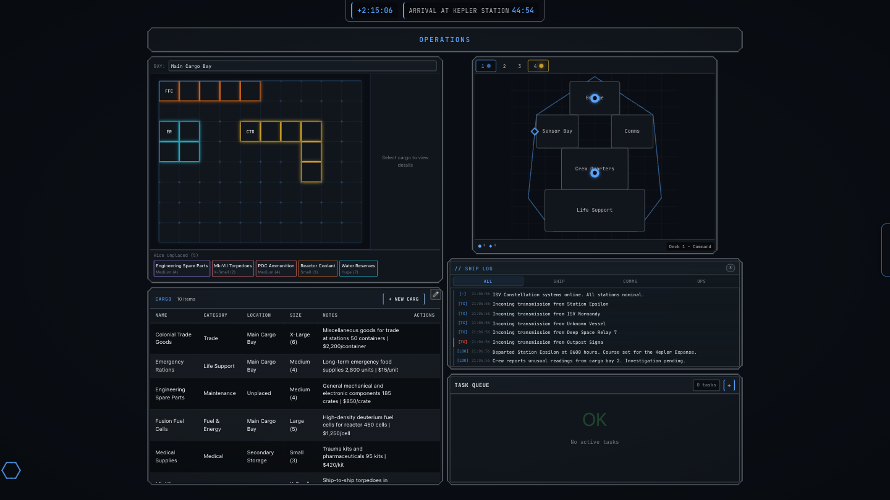
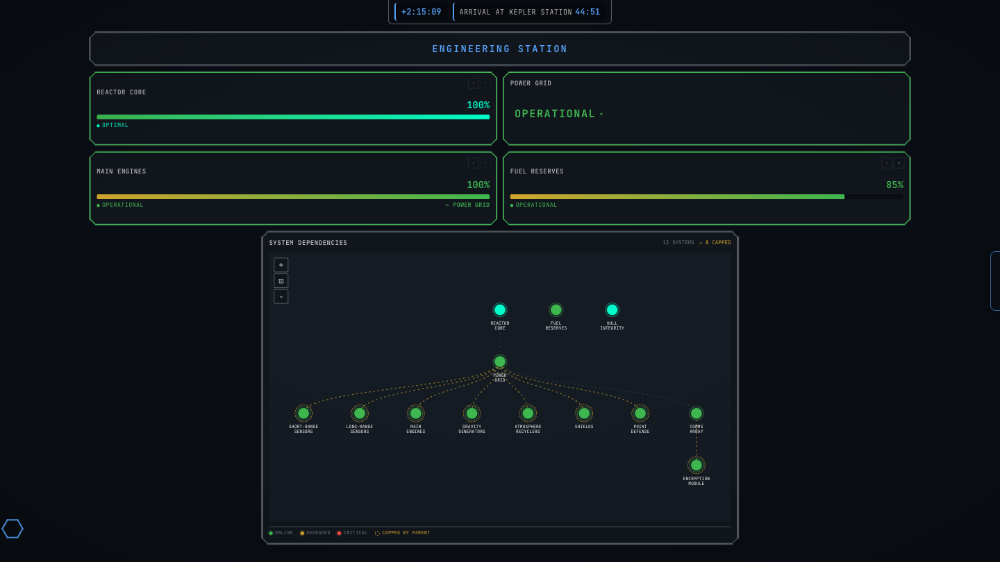
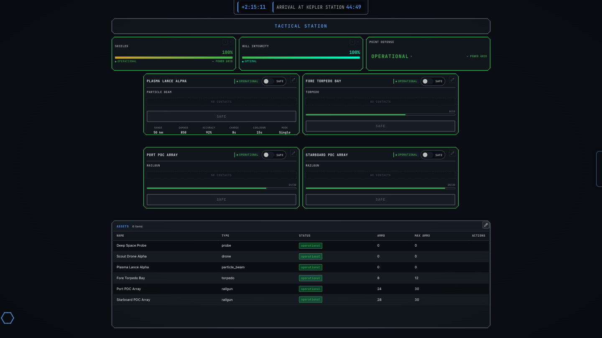
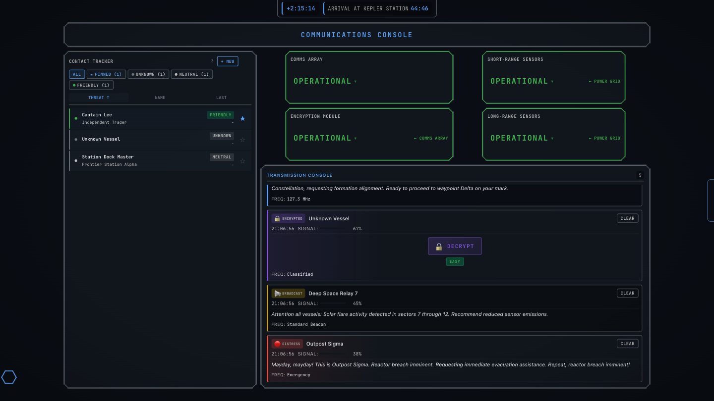
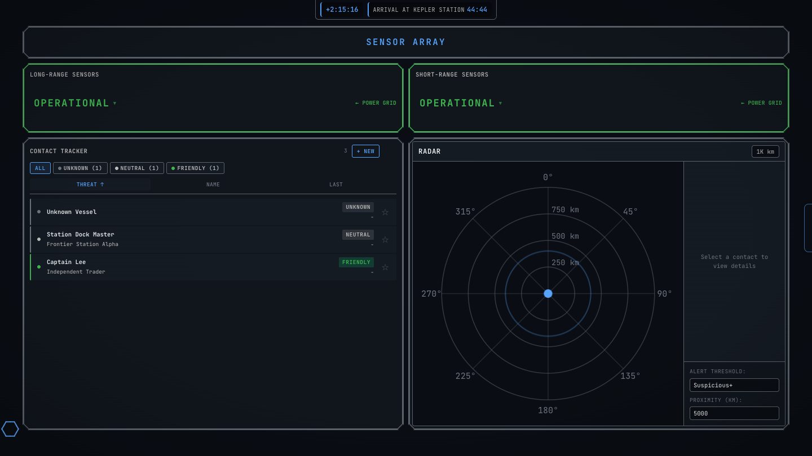
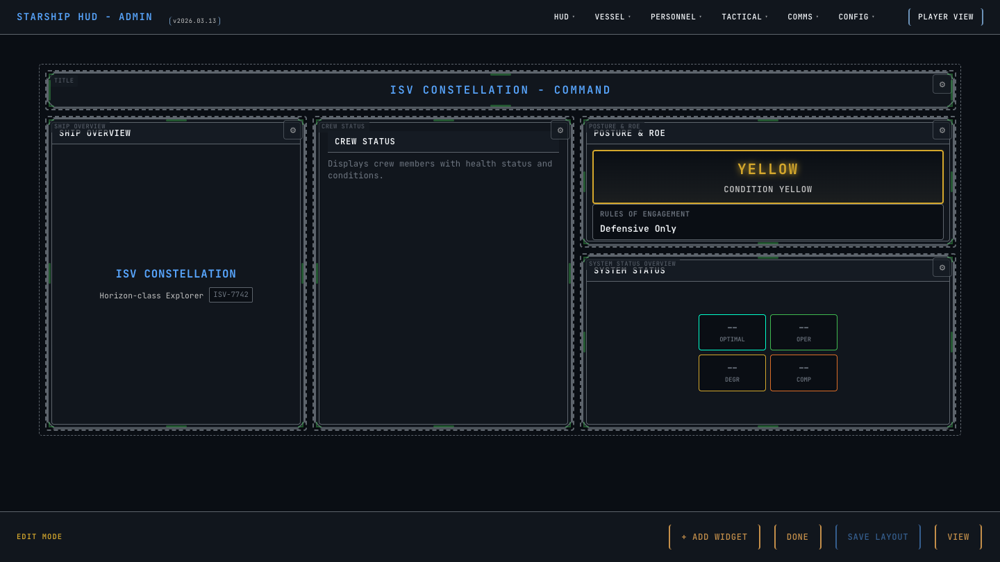
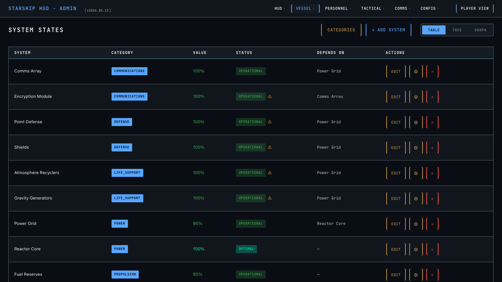
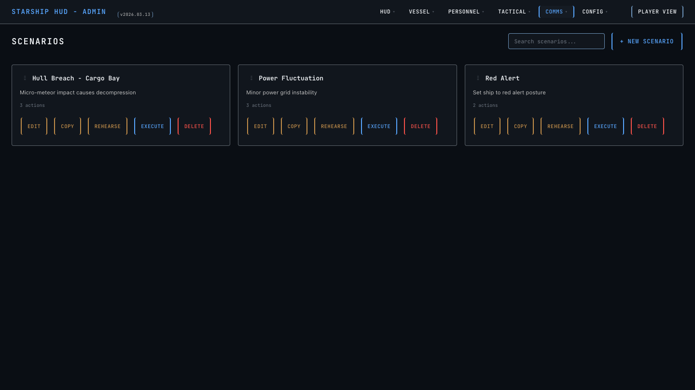
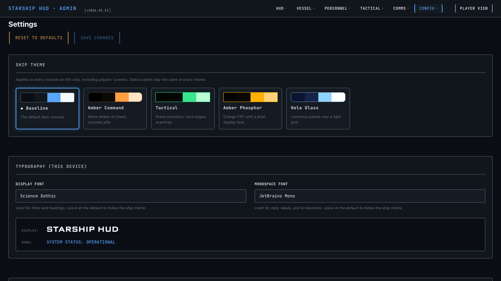

# Screenshots

The demo ship, ISV Constellation, as a fresh install shows it. Every panel here is a starting
point: the GM can rearrange, resize, add or remove any widget, and build panels for stations the
demo doesn't have.

- [Player consoles](#player-consoles): [Command](#command) · [Operations](#operations) · [Engineering](#engineering) · [Tactical](#tactical) · [Comms](#comms) · [Sensors](#sensors)
- [Ship themes](#ship-themes)
- [The GM's side](#the-gms-side): [Dashboard](#gm-dashboard) · [Panel builder](#panel-builder) · [Systems](#systems) · [Scenarios](#scenarios) · [Settings](#settings)

---

## Player consoles

### Command

The captain's view of the whole ship: the ship's overview and reputation, the crew and their
condition, the current posture and rules of engagement, and a count of systems by status.

### Operations

Running the ship day to day: the cargo bay with each crate on its grid, a holomap of the decks
with crew markers, the cargo manifest, the ship log and the task queue.

### Engineering

Keeping it all running: reactor, engines and fuel as gauges, the power grid's status, and the
dependency graph that shows how a fault in one system caps everything downstream of it.

### Tactical

Weapons and defence: shields, hull and point defence, each weapon with its target, ammunition and
safety, and the full list of the ship's assets.

### Comms

The ship's voice: known contacts and their standing, the comms and sensor systems, and incoming
transmissions, including an encrypted one waiting to be cracked.

### Sensors

What is out there: long- and short-range sensor status, the contact tracker with threat levels,
and the radar.

---

## Ship themes

The GM picks one theme per ship and every console follows it live. Status colours are the same in
every theme, so a critical system always reads as critical.

| Amber Command | Tactical |
|---|---|
|  |  |
| LCARS-style colour bands and pills | A green terminal with corner brackets and scanlines |

| Amber Phosphor | Holo Glass |
|---|---|
|  |  |
| An orange CRT with a pixel display face | Frosted, glowing panels over a light grid |

The default theme is the one in the player console screenshots above.

---

## The GM's side

### GM dashboard

Home base during a session: the ship at a glance, posture, every system's status and one-click
scenarios. It is a panel like any other, so the GM can customise it.

### Panel builder

Drag widgets onto the grid, resize them, and open any widget's settings to configure it or bind it
to a ship system.

### Systems

Every ship system with its value, status and what it depends on. Change one here and the effect
cascades to everything that depends on it.

### Scenarios

Scripted moments: rehearse one to see exactly what it will change, then run it. A scenario applies
completely or not at all.

### Settings

Choose the ship's theme, and fonts and accent colours for this device.
